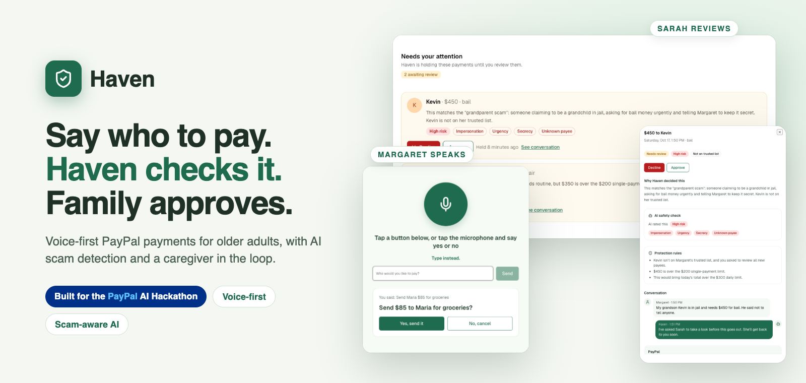
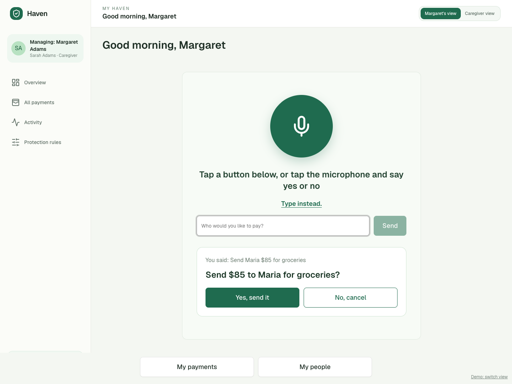
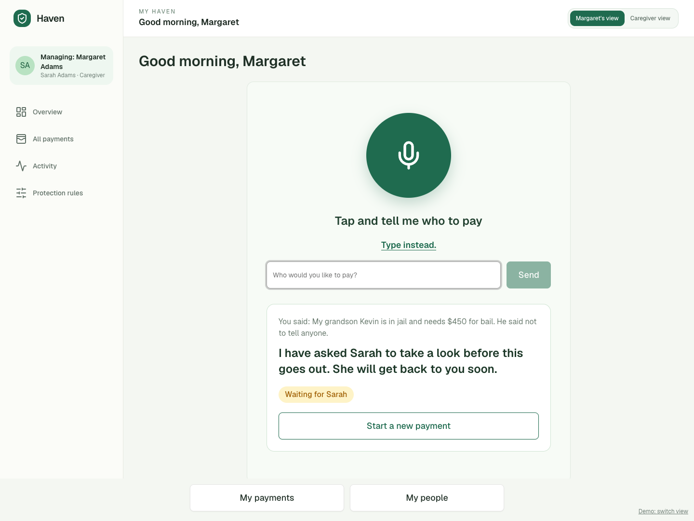
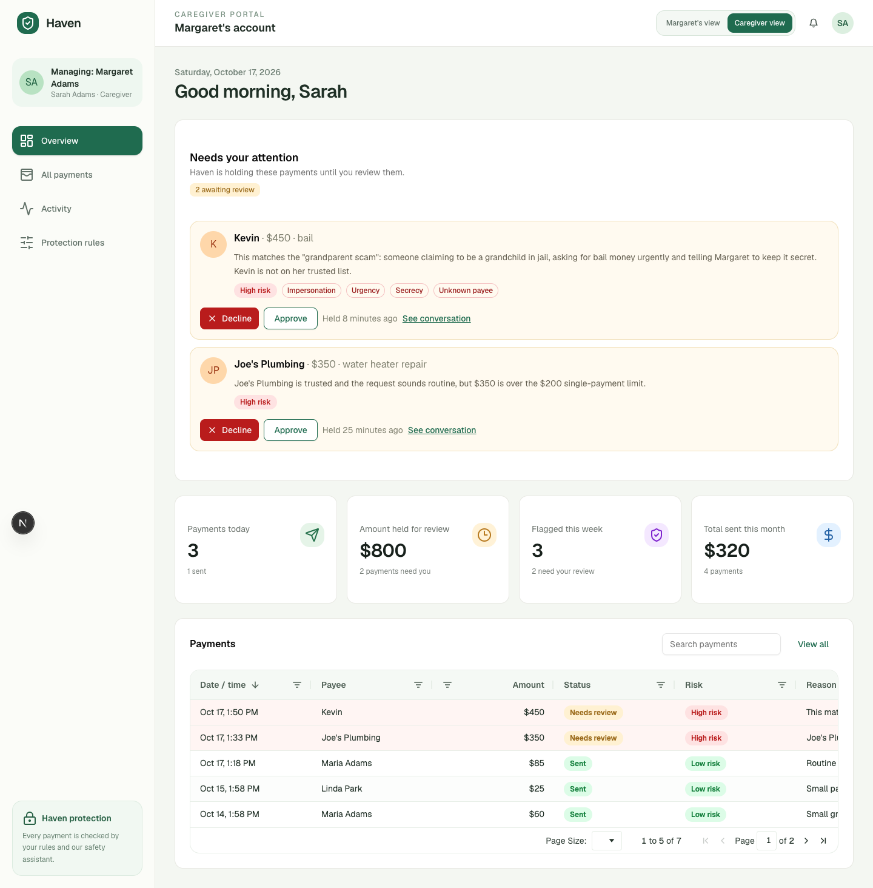
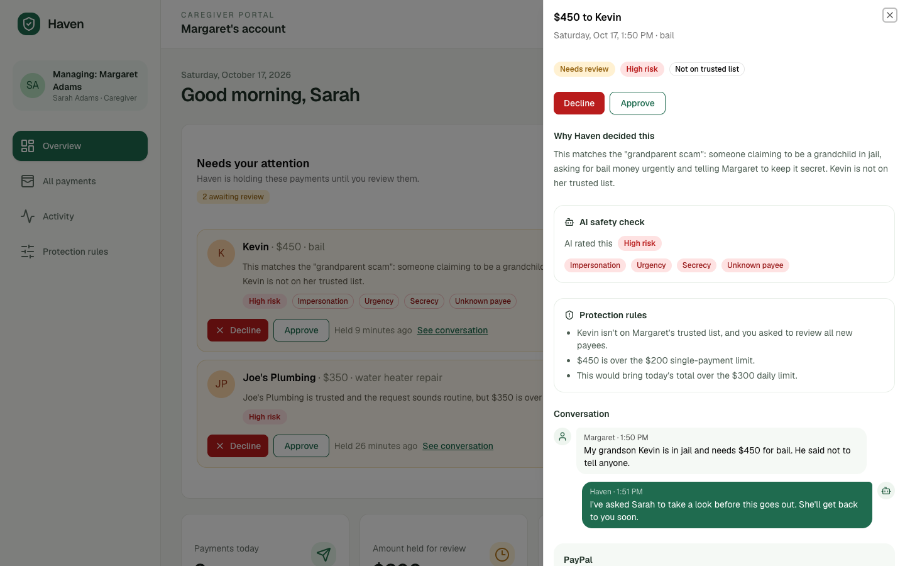
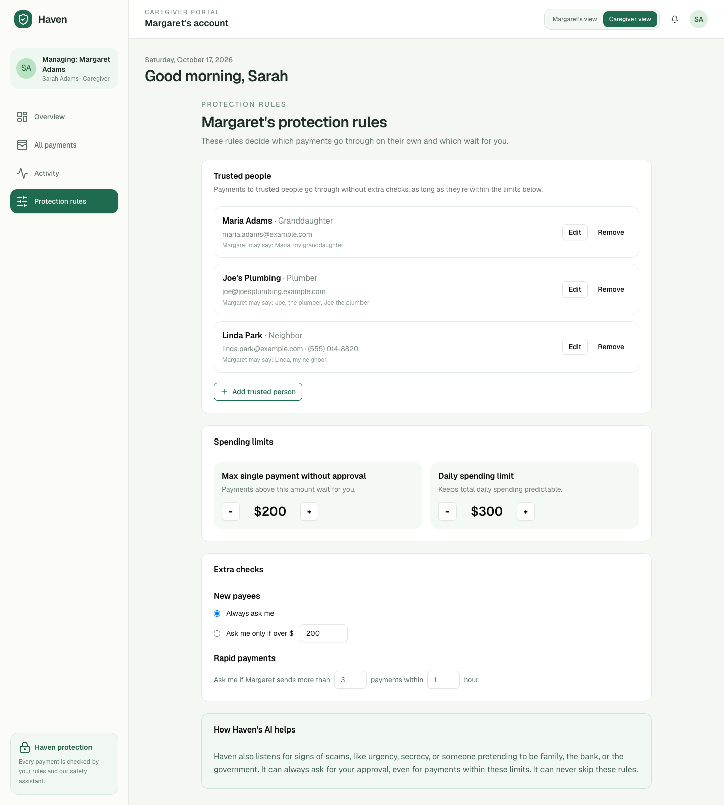
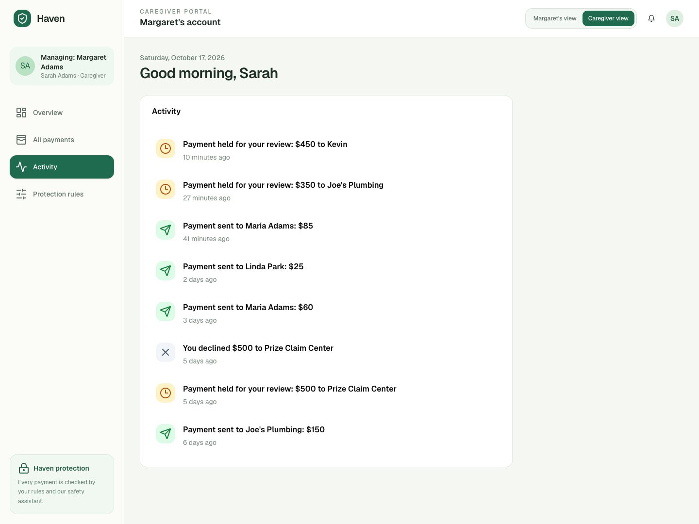
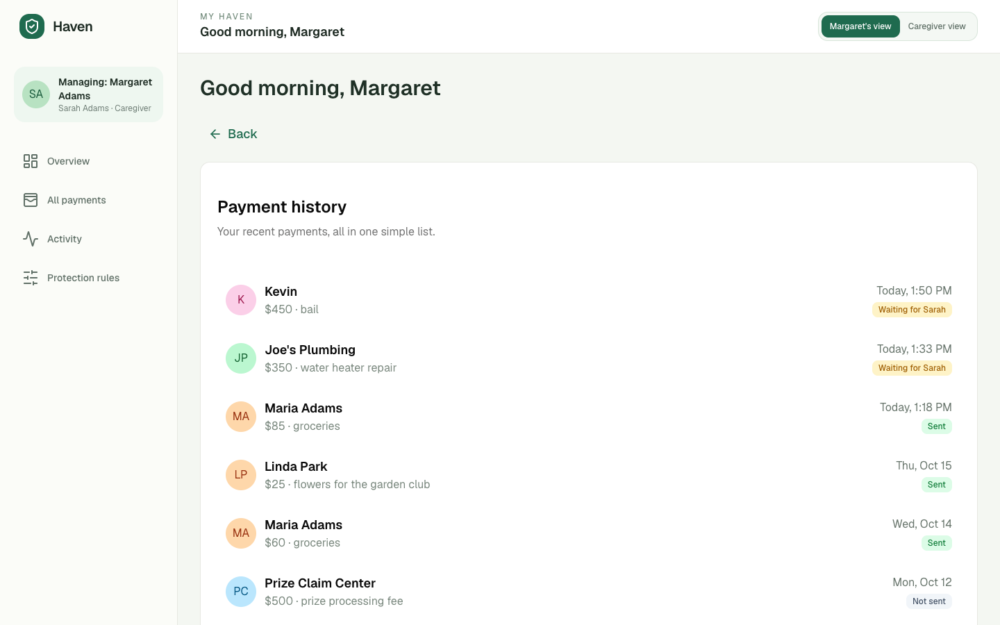
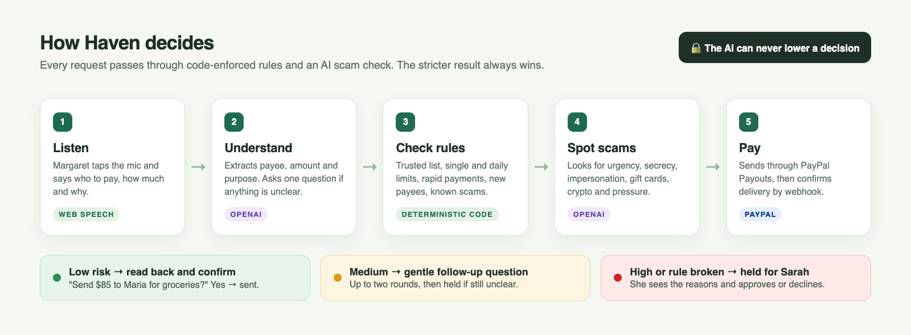

<p align="center">
  
</p>

<p align="center">
  <b>Voice-first PayPal payments for older adults, with AI scam detection and a caregiver in the loop.</b>
</p>

<p align="center">
  
  
  
  
  
</p>

---

## 🎬 See it in action

Haven has two sides. **Margaret** (the senior) just talks. **Sarah** (her caregiver) sets the rules and reviews anything risky.

<table>
  <tr>
    <th width="50%">🗣️ Margaret says <i>"Send Maria $85 for groceries"</i></th>
    <th width="50%">🚨 Margaret says <i>"My grandson Kevin is in jail and needs $450 for bail…"</i></th>
  </tr>
  <tr>
    <td></td>
    <td></td>
  </tr>
  <tr>
    <td>✅ Maria is trusted and within limits. Haven reads the payment back, Margaret says <b>yes</b>, and it's sent through PayPal.</td>
    <td>🛑 New payee, over the limits, and the AI spots <b>impersonation, urgency and secrecy</b>. The payment is held and Sarah is asked to review it.</td>
  </tr>
</table>

### Sarah sees exactly why it was held



<table>
  <tr>
    <td width="50%"></td>
    <td width="50%"></td>
  </tr>
  <tr>
    <td align="center"><b>Why Haven decided this</b><br>The AI's scam signals, every rule that fired, and the full conversation, with Approve or Decline in one tap.</td>
    <td align="center"><b>Protection rules</b><br>Trusted people, single-payment and daily limits, new-payee and rapid-payment checks.</td>
  </tr>
  <tr>
    <td width="50%"></td>
    <td width="50%"></td>
  </tr>
  <tr>
    <td align="center"><b>Activity feed</b><br>Every payment that was sent, held or declined, as it happens.</td>
    <td align="center"><b>Margaret's history</b><br>Big, plain-language statuses like <i>Sent</i> and <i>Waiting for Sarah</i>.</td>
  </tr>
</table>

---

## 💡 What is Haven?

Haven was built for the **PayPal AI Hackathon**. It lets an older adult send money through PayPal just by saying what they want. Before any money moves, every request passes through the caregiver's protection rules and an AI scam check:

- 🟢 **Routine payments** to trusted people are confirmed in one step.
- 🟡 **Unclear requests** get one or two gentle follow-up questions.
- 🔴 **Anything risky** is held until a family caregiver approves it.

## ⚙️ How it works



**The AI can never lower a decision.** If the rules say HOLD, nothing the model outputs, and nothing a scammer coaches the senior to say, can release the payment without caregiver approval. This is enforced in code ([`lib/decision/combine.ts`](lib/decision/combine.ts)), not just in the prompt, and tested against every pairing of rules and AI result.

<details>
<summary><b>More safety details</b></summary>

- The payee is matched to the trusted list by **code**, not by the AI ([`lib/payees/resolve.ts`](lib/payees/resolve.ts)).
- AI output is validated with zod. Any error, refusal, malformed JSON or unknown value is treated as **high risk**.
- The transcript is passed to the model fenced as evidence, never as instructions.
- Amounts and purposes must appear in what the senior actually said.
- Rules are re-checked when Margaret says "yes", and a spoken yes/no is interpreted by code (anything that sounds like "no" cancels).
- Each payment can be paid only once: a database claim runs before calling PayPal, and the `sender_batch_id` is derived from the payment ID, so retries and double-taps can't create a second payout.

</details>

## 🧰 Built with

| | |
|---|---|
| **PayPal Payouts API** | Sends approved payments (sandbox), with duplicate-batch detection |
| **PayPal Webhooks** | Signature-verified payout events update each payment to sent or failed |
| **OpenAI** | Structured Outputs for parsing requests and scoring scam risk ([`prompts/`](prompts)) |
| **AG Grid** | The caregiver's live, filterable payments table |
| **Next.js 16 · React 19 · Tailwind · shadcn/ui** | App and API routes (UI started in v0) |
| **PostgreSQL + Drizzle** | Payees, rules, payments, conversations, webhook events |
| **Web Speech API** | Speech-to-text and spoken replies in the browser |
| **Render** | One web service plus Postgres, via [`render.yaml`](render.yaml) |

---

## 🚀 Getting started

**You need:** Node 20.9+ (22 recommended), PostgreSQL, an OpenAI API key and a PayPal Developer sandbox app.

```bash
npm install
createdb haven
touch .env              # add your keys (see Environment variables below)
npm run db:setup         # migrate + seed demo data
npm run dev              # http://localhost:3000
```

> Use Chrome, Edge or Safari for voice. Typing works in every browser.

<details>
<summary><b>PayPal sandbox setup</b></summary>

1. At [developer.paypal.com](https://developer.paypal.com), in **Sandbox** mode, open **Apps & Credentials** and create an app with Payouts enabled. Copy its Client ID and Secret into `.env`.
2. Under **Testing Tools → Sandbox Accounts**, create three **Personal** (US) accounts for Maria, Joe and Linda, put their emails in `SANDBOX_EMAIL_*`, then run `npm run db:seed`.
3. Webhooks need a public HTTPS URL. Locally, run a tunnel (e.g. `ngrok http 3000`), then:
   ```bash
   npm run paypal:webhook -- https://your-tunnel.example
   ```
   Put the printed ID in `PAYPAL_WEBHOOK_ID`. Without webhooks, Haven still updates statuses by polling PayPal.

</details>

<details>
<summary><b>Environment variables</b></summary>

| Variable | Required | Description |
|---|---|---|
| `DATABASE_URL` | yes | Postgres connection string |
| `DATABASE_SSL` | no | `true` when connecting to Render's external database URL |
| `TEST_DATABASE_URL` | no | Throwaway database for integration tests (it is wiped) |
| `OPENAI_API_KEY` | yes | OpenAI API key |
| `OPENAI_PARSE_MODEL` | no | Parsing model. Default `gpt-6-luna` |
| `OPENAI_RISK_MODEL` | no | Risk model. Default `gpt-6.1-sol` |
| `PAYPAL_CLIENT_ID` / `PAYPAL_CLIENT_SECRET` | yes | PayPal sandbox app credentials |
| `PAYPAL_API_BASE` | no | Default `https://api-m.sandbox.paypal.com` |
| `PAYPAL_WEBHOOK_ID` | for webhooks | Used for webhook signature verification |
| `SANDBOX_EMAIL_MARIA`, `_JOE`, `_LINDA` | recommended | Sandbox emails for the seeded trusted payees |
| `DEMO_TIME_ZONE` | no | Time zone for the daily limit. Default `America/New_York` |
| `DEMO_RESET_TOKEN` | no | Enables `POST /api/admin/reset-demo` |

</details>

<details>
<summary><b>Scripts</b></summary>

| Command | What it does |
|---|---|
| `npm run dev` | Start in development mode |
| `npm run db:setup` | Migrate; seed demo data only if the database is empty |
| `npm run db:seed` | **Reset** to the demo state (run before each demo) |
| `npm test` | Run the 209-test suite |
| `RUN_LIVE_AI=1 npm test -- ai-live` | Also test against the real OpenAI API |
| `npm run try -- "Send Maria $85"` | Talk to the pipeline in the terminal (nothing is sent) |
| `npm run paypal:smoke` | Send a real $1 sandbox payout and watch it settle |
| `npm run paypal:webhook -- <url>` | Register the PayPal webhook and print its ID |

</details>

<details>
<summary><b>Deploying on Render</b></summary>

1. In Render: **New → Blueprint**, select this repo. It creates the `haven` web service and `haven-db` database from `render.yaml`.
2. Fill in `OPENAI_API_KEY`, `PAYPAL_CLIENT_ID`, `PAYPAL_CLIENT_SECRET` and `SANDBOX_EMAIL_*`. Leave `PAYPAL_WEBHOOK_ID` empty for now.
3. After the first deploy, register the webhook and set the printed ID as `PAYPAL_WEBHOOK_ID`:
   ```bash
   npm run paypal:webhook -- https://<your-service>.onrender.com
   ```
4. To reset demo data (no shell on the free plan):
   ```bash
   curl -X POST https://<your-service>.onrender.com/api/admin/reset-demo -H "Authorization: Bearer <DEMO_RESET_TOKEN>"
   ```

**Free plan caveats:** the service sleeps after 15 minutes idle (open it a minute before demoing), and a free Postgres database expires 30 days after creation.

</details>

<details>
<summary><b>Project structure</b></summary>

```
app/api/converse          one senior turn (speech/text → reply)
app/api/caregiver/...     payments, approve, decline, rules
app/api/webhooks/paypal   PayPal webhook receiver
components/haven/         screens and the AG Grid table
lib/rules/engine.ts       deterministic rules
lib/ai/                   parsing and risk assessment
lib/decision/combine.ts   rules + AI → decision (stricter wins)
lib/conversation/         multi-turn state machine
lib/paypal/               OAuth, Payouts, webhook verification
lib/db/                   Drizzle schema and demo seed
prompts/                  system prompts (edit to tune the AI)
```

</details>

<details>
<summary><b>Known limitations</b></summary>

- **Only protects payments made through Haven.** Other PayPal activity, bank transfers, gift cards and cash aren't covered.
- **Sandbox only, no authentication.** One hardcoded caregiver and senior, switched by the demo toggle.
- **The known-scam list is hardcoded**, behind a swappable `ScamSource` interface.
- **Basic, in-memory rate limiting** on `/api/converse`, and a single server instance is assumed.
- **Voice depends on the browser:** Chrome, Edge and Safari, not Firefox. Typing always works.
- **AI wording can vary between runs**, but the AI can only make a decision stricter.

</details>

## 📄 License

[MIT](LICENSE)
